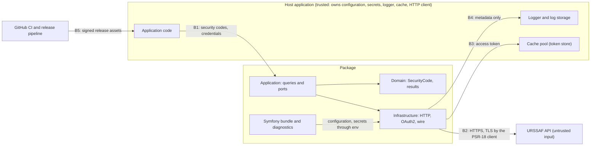

# Security assurance case

This document argues why the security requirements of `thebeardedbear/urssaf-attestations-verification-code-securite`
are met. It is grounded in a review of the code at the commit named in the [security review](security-review-2026-11.md):
each claim points to the file that implements it, and the document states its limits. The package is a library, so
part of the security of a deployment belongs to the host application (see
[Assumptions on the host](#7-assumptions-on-the-host-application)).

Reporting a vulnerability: [SECURITY.md](../../SECURITY.md).

## 1. What is protected

The package asks the URSSAF "API Attestations Vérification Code Sécurité" whether a certificate (*attestation de
vigilance*, CSG/CRDS, formation professionnelle, micro-entrepreneur turnover, ...) identified by the security code
printed on it is valid, and returns the answer as typed values. The API is read-only: nothing is created or changed on
the URSSAF side, and the package stores nothing but a cached access token. Authentication is OAuth2 client credentials.

| Asset | Where it lives | Sensitivity |
|---|---|---|
| OAuth2 `client_id` / `client_secret` of each tenant | Host configuration or `CredentialsProvider`; in memory in `Application\Port\Credentials` | Secret |
| Access token | `TokenStore` (PSR-6 / PSR-16 cache pool or memory), in memory during a call | Secret, short lived |
| Security codes sent for verification | Host application, URL query (`GET`) or JSON body (`POST`) sent to URSSAF, `Domain\Certificate\SecurityCode` | Bearer-like: whoever holds a code can read the certificate details it unlocks |
| Verification results: holder name (`denomination`), SIREN, NIR (social security number), last and first names, establishments, issuing body | `Domain\Certificate\VerifiedCertificate` and `Details\*`, in the memory of the host application | Personal data (GDPR) |
| Verdict itself (valid, expired, unknown) | `VerifiedCertificate` / `RejectedCode` | Integrity critical: a host may use it to decide whether to work with a company |
| Source code and releases | GitHub repository, Packagist, release assets | Integrity critical (supply chain) |

The package has no database, no Doctrine mapping, no outbox and no persisted verification log
([ADR 0001](../adr/0001-stateless-sdk.md)): anything stored about a verification is stored by the host.

## 2. Security requirements

| ID | Requirement |
|---|---|
| SR1 | Credentials and tokens are never persisted by the package (the token cache aside, with a bounded lifetime), never logged, never present in exception messages, and masked when dumped. |
| SR2 | Personal data returned by URSSAF (holder name, NIR, names) is never logged by the package, never present in exception messages, and masked when a result is dumped. |
| SR3 | The verdict returned to the host is what URSSAF answered for the codes the host asked about: codes are sent unaltered, the response is parsed strictly, and a malformed or incoherent response is an error, never a verdict. |
| SR4 | Everything received from URSSAF is untrusted: parsed strictly, never executed or deserialised into arbitrary objects, and a malformed response fails closed. |
| SR5 | Requests are authenticated and sent to the intended URSSAF host; one tenant can neither use nor see another tenant's credentials. |
| SR6 | A failure of URSSAF or of the network degrades gracefully: typed exceptions, `Retry-After` honoured as information, no hidden retry loop (the single replay after a 401 aside). |
| SR7 | The code and the release artefacts come from the maintainers' reviewed and tested commits and can be verified by consumers. |

## 3. Threat model

| Actor | Capability considered | Main threats |
|---|---|---|
| Network attacker | Observes or tampers with traffic between the host and URSSAF | Eavesdropping on tokens, security codes or results; response tampering (a forged "valid" verdict); downgrade |
| Malicious or compromised URSSAF endpoint (or a proxy configured as such) | Returns arbitrary bodies, statuses and sizes | Injection through response fields, deserialisation, resource exhaustion, secrets in error text, a verdict for a code that was not asked |
| Host application bug or misconfiguration | Controls configuration, logger, cache, HTTP client | Secrets in clear configuration, `http://` base URI, shared cache pool, verbose logging of requests (the security code travels in the URL of the `GET` operation) |
| Other tenant of a multi-tenant host | Uses the same host application | Use of another tenant's credentials or cached token |
| Hostile user-supplied data | A security code typed by an end user reaches the package through the host | Malformed values reaching URSSAF, URL or JSON injection through the code |
| Malicious contributor, poisoned dependency, abused CI token | Pull request, dependency update, workflow permissions | Backdoor in the package, secret exfiltration from CI, tampered release |

Out of scope: compromise of the host server itself, and the security of the URSSAF platform (see
[SECURITY.md](../../SECURITY.md#scope)).

## 4. Trust boundaries

| Boundary | What crosses | Control in the package |
|---|---|---|
| B1 host to package | Security codes and credentials | `SecurityCode` has a private constructor and trims its input, rejecting a blank value (`Domain/Certificate/SecurityCode.php`; the specification defines no stricter format, see finding SR-05); `TenantId` is non-blank and at most 64 characters; credentials only through `CredentialsProvider` |
| B2 package to URSSAF | HTTPS requests with a bearer token; untrusted responses | TLS and certificate verification are delegated to the PSR-18 client; query built with `http_build_query(..., PHP_QUERY_RFC3986)`; body built with `json_encode`; strict JSON decoding and typed mapping (`Infrastructure/Urssaf/Wire`) |
| B3 package to cache | Access token | Hashed cache key (`sha256` of environment, base URI and client id), item expires with the token, a malformed item is a cache miss |
| B4 package to logs | Technical metadata | Fixed set of fields: method, path (without the query string), status, duration, request id, exception class |
| B5 pipeline to consumers | Releases | Pinned actions, least-privilege tokens, SLSA provenance, checksums |

Inside the package, Deptrac enforces the layers that separate these zones (`deptrac.yaml`).

## 5. Secure design principles

Saltzer and Schroeder principles mapped to the code.

| Principle | How it is applied | Where |
|---|---|---|
| Economy of mechanism | No third-party runtime code: `require` lists only PSR interfaces and PHP extensions. The HTTP client, cache and logger come from the host. The only own encoder is a few lines around `json_encode`. | `composer.json`, `Infrastructure/Urssaf/Wire/JsonEncoder.php` |
| Fail-safe defaults | `environment` is mandatory in the bundle (no implicit production) and unknown values are rejected. The simulated gateway cannot be combined with `environment: production`. The default logger is a `NullLogger`. A malformed cached token is a cache miss. | `Bridge/Symfony/DependencyInjection/BundleConfiguration.php`, `ConfigurationRules.php`, `Infrastructure/TokenStore/CachedAccessToken.php`, `Infrastructure/Urssaf/Http/JsonApiClient.php` |
| Complete mediation | Every URSSAF call goes through `JsonApiClient::exchange()` (bearer token, request id, status mapping), and every result is built by `VerificationResultMapper`. Value objects have private constructors, so every instance went through validation. | `Infrastructure/Urssaf/Http/JsonApiClient.php`, `Infrastructure/Urssaf/Wire/VerificationResultMapper.php`, `src/Domain/**` |
| Open design | Open source, documented protocol mapping, public quality thresholds. Nothing relies on secrecy of the code. | `README.md`, `docs/api-reference.md`, `CONTRIBUTING.md` |
| Separation of privilege | Strict layers: Domain depends on nothing, Application on Domain, Infrastructure and the Symfony bridge on the layers below. | `deptrac.yaml` |
| Least privilege | Credentials fetched per tenant on demand; a single OAuth2 scope (`attn.codes_securite`); the installation check has its own checks that do not touch the application tokens; CI workflows default to `contents: read` and elevate per job. | `Application/Port/CredentialsProvider.php`, `Infrastructure/Urssaf/UrssafEndpoints.php`, `Bridge/Symfony/Diagnostic/*`, `.github/workflows/*.yml` |
| Least common mechanism | Token cache key is `sha256(environment, base URI, client id)`: tenants with different credentials never share a token (two tenants configured with the same client id deliberately do). | `Infrastructure/Urssaf/Http/OAuth2TokenProvider.php`, `docs/standalone.md` |
| Psychological acceptability | The secure path is the default path: secrets through `%env()%`, one factory to build the gateway, a `urssaf:check` installation diagnostic, a simulated gateway so tests never call URSSAF. | `docs/symfony.md`, `docs/testing.md`, `Bridge/Symfony/Diagnostic/*`, `Testing/SimulatedCertificateVerificationGateway.php` |
| Defence in depth | Secrets are masked in `__debugInfo()`, marked `#[SensitiveParameter]`, not serialisable, not logged, absent from exception messages. Personal data of results (denomination, NIR, names) is masked in dumps. | `Application/Port/Credentials.php`, `AccessToken.php`, `Domain/Certificate/VerifiedCertificate.php`, `Domain/Certificate/Details/{Amp,Asaa,Avg}Details.php` |
| Fail securely | HTTP errors become typed exceptions carrying the status and URSSAF error codes. An unexpected status or body raises `UnexpectedUrssafResponse` instead of being interpreted. A result item must carry exactly one of a certificate or a fault, and the number of results must match the number of codes sent. Exactly one replay after a 401, no other automatic retry. | `Infrastructure/Urssaf/Http/JsonApiClient.php`, `Wire/VerificationResultMapper.php`, `UrssafHttpGateway.php` |
| Integrity by construction | A rejected code is an answer (`RejectedCode`), never an exception and never confused with a valid certificate: the two are distinct types of the closed `VerificationResult` set ([ADR 0002](../adr/0002-verification-result-model.md)). Batches are capped at 100 codes and split by the handler. | `Domain/Certificate/VerificationResult.php`, `Application/Query/VerifyCertificatesHandler.php` |

## 6. Common implementation weaknesses and how they are countered

| Weakness (OWASP Top 10 2021 / CWE) | Countermeasure | Where, verified by |
|---|---|---|
| SQL injection (A03, CWE-89) | Not applicable: the package has no database access and no SQL. | `src/` (no DBAL or ORM use; Doctrine is a development dependency only) |
| HTTP, header and form injection (CWE-93, CWE-113) | Query and token body built with `http_build_query(..., PHP_QUERY_RFC3986)`; paths are constants; header values come from configuration or generated ids. The security code is only ever a query value or a JSON string. | `JsonApiClient::buildRequest()`, `OAuth2TokenProvider::fetch()`, `UrssafEndpoints.php` |
| JSON injection (CWE-116) | The request body is built by `json_encode` with `JSON_THROW_ON_ERROR` from arrays of strings. | `Wire/JsonEncoder.php`, `Wire/VerifyManyRequestMapper.php` |
| Sensitive data exposure (A02, CWE-200, CWE-532) | Logs hold method, path (no query string), status, duration, request id and exception class; bodies, tokens and security codes are never logged. Exception messages hold operation names, statuses and URSSAF error codes. Debug output of credentials, tokens and personal data is masked. The security code travels in the URL of the `GET` operation: the host must not log full URLs (see assumptions, and `verifyMany` for a body-only alternative). | `JsonApiClient`, `OAuth2TokenProvider`, `Application/Port/Credentials.php`, `Domain/Certificate/VerifiedCertificate.php`; unit tests |
| Cleartext transmission, improper certificate validation (CWE-319, CWE-295) | Default base URIs are `https://`. The package never disables verification (no `verify_peer`, `CURLOPT_*` or stream-context option in `src`). The default Symfony client has a timeout (`http_timeout`, 15 s). The scheme of an overridden base URI is not enforced (finding SR-01). | `Infrastructure/Urssaf/Environment.php`, `GatewayRegistrar.php` |
| Insecure deserialisation (A08, CWE-502) | Responses are decoded with `json_decode` into arrays, never `unserialize`. A cached token must have the exact array shape and types. `Credentials` refuses serialisation. | `Wire/JsonDecoder.php`, `TokenStore/CachedAccessToken.php`, `Application/Port/CredentialsNotSerializable.php` |
| Improper input validation (CWE-20) | Blank security codes and tenant ids are rejected; tenant ids are length-bounded; the response is read through typed accessors (`Payload`), dates are decoded strictly (`d/m/Y`, impossible dates rejected), the nature code is kept as an opaque string. | `Domain/Certificate/SecurityCode.php`, `Domain/Shared/TenantId.php`, `Wire/Payload.php`, `Wire/DateEncoding.php` |
| Incoherent or forged verdicts (CWE-345, CWE-354) | An item with both or neither of a certificate and a fault is rejected; the result count must match the request. The correlation of a result with the code asked is not checked (finding SR-03). | `Wire/VerificationResultMapper.php`, `UrssafHttpGateway.php` |
| Hard-coded credentials (CWE-798) | None in the repository; secrets come from the host; fixtures use fictitious values; GitHub secret scanning with push protection is enabled. | `CONTRIBUTING.md`, repository settings |
| Weak randomness (CWE-330, CWE-338) | `random_bytes()` through `SecureRandomBytes` for the request id (RFC 4122 v4 layout). No `rand`, `mt_rand` or `uniqid` in `src`. | `Infrastructure/Id/*` |
| Authentication failures (A07) | Client-credentials flow; the token is renewed `token_safety_margin` seconds early (default 60); a 401 invalidates the cached token and triggers one replay; 400, 401, 403 on the token endpoint raise `UrssafAuthenticationFailed` and are not retried. | `OAuth2TokenProvider`, `JsonApiClient::exchange()` |
| Broken access control, tenant isolation (A01, CWE-639) | Credentials resolved per tenant through `CredentialsProvider` (unknown tenant: `RecordNotFound`); the token cache key includes the client id. | `Infrastructure/Credentials/InMemoryCredentialsProvider.php`, `OAuth2TokenProvider::cacheKey()` |
| Resource exhaustion (CWE-400, CWE-770) | Client timeout, batch size cap (`MAX_CODES_PER_CALL` = 100), JSON depth limit, one replay at most. The response body size is not capped by the package (finding SR-02). | `UrssafHttpGateway`, `VerifyCertificatesHandler`, `Wire/JsonDecoder.php` |
| Vulnerable and outdated components (A06) | No third-party runtime code. Development tooling: `composer audit` in CI and `make composer-checks`, Dependabot weekly (Composer and GitHub Actions), committed `composer.lock`. | `composer.json`, `.github/dependabot.yml`, `.github/workflows/ci.yml` |
| Supply chain, integrity failures (A08) | Actions pinned to a commit SHA; `contents: read` by default, elevated per job; no `pull_request_target`; CodeQL for workflows; OpenSSF Scorecard; releases carry `SHA256SUMS` and a SLSA provenance attestation; `main` is protected and changes go through reviewed pull requests with a DCO sign-off. | `.github/workflows/*.yml`, `.github/actions/setup/action.yml`, `SECURITY.md`, `CONTRIBUTING.md` |
| Logging and monitoring failures (A09) | Metadata-only logs on a dedicated `urssaf` channel; `urssaf:check` diagnostics. | `GatewayRegistrar.php`, `Bridge/Symfony/Diagnostic/*` |
| SSRF (A10, CWE-918) | The path is a constant; only the base URI is variable and it is operator configuration, never derived from URSSAF responses or user input. | `Infrastructure/Urssaf/ApiConfiguration.php`, `UrssafEndpoints.php` |
| Insecure design (A04) | The threat model above, layers enforced by tooling, a closed result type that makes a rejected code unrepresentable as a valid certificate. | `deptrac.yaml`, `Domain/Certificate/VerificationResult.php` |

### Tools that verify these countermeasures

| Tool | What it checks | Where it runs |
|---|---|---|
| PHPStan level max (strict, deprecation, Symfony, PHPUnit rules) | Type safety, unsafe patterns | CI `phpstan`, `make phpstan` |
| Mago lint and analyze (`--minimum-fail-level=note`) | Static analysis | CI `mago`, `make mago` |
| Deptrac | Layer boundaries inside the package | CI `deptrac`, `make deptrac` |
| PHPUnit with 100% line, method and class coverage | Behaviour including failure paths | CI `coverage`, `bin/check-coverage` |
| Branch coverage (Xdebug path coverage, at least 96 %) | Failure branches are exercised | CI `coverage-branches` (main, nightly, on demand), `make coverage-branches` |
| Infection with 100% MSI and covered MSI | The tests detect behaviour changes | CI `infection`, `make infection` |
| SonarQube Cloud (when enabled by the repository variable) | Vulnerabilities, security hotspots | CI `sonarcloud` |
| `composer audit`, Dependabot | Known vulnerable dependencies | CI `composer-checks`, Dependabot |
| CodeQL on the GitHub Actions workflows | Workflow injection, excessive permissions | `.github/workflows/codeql.yml` |
| OpenSSF Scorecard | Supply-chain practices | `.github/workflows/scorecard.yml` |
| SLSA provenance attestation and `SHA256SUMS` | Provenance of release archives | `.github/workflows/release.yml` |
| GitHub secret scanning with push protection | Committed secrets | Repository setting |
| DCO sign-off check | Origin of every contribution | CI `dco`, `bin/check-dco` |

## 7. Assumptions on the host application

The assurance above holds if the host application:

1. keeps `client_secret` in a secret store or environment variable (a literal in committed configuration ends up in
   the compiled container) and restricts who can read it;
2. provides a PSR-18 client that verifies TLS certificates, with safe redirect behaviour, and does not override the
   base URI with a non-HTTPS URL outside tests;
3. uses a token cache pool private to the application: the access token is stored there in clear for its lifetime;
4. does not log request or response bodies nor full request URLs at its own HTTP-client or proxy level (the security
   code is a query parameter of the `GET` operation), and does not put security codes or personal data in the
   messages of its own exceptions and logs;
5. treats the verification results as personal data: the package returns them to the host and keeps nothing, so the
   host decides what it stores, for how long, and applies its own retention and erasure policy (GDPR);
6. validates what an end user may type as a security code before offering it to the package if it applies a stricter
   format than the one of the specification, and rate-limits its own users: the package has no client-side rate
   limiter ([ADR 0004](../adr/0004-quotas-and-retry.md)) and a public form calling it can be abused to enumerate codes.

## 8. Residual risks

The open items are tracked in the [security review](security-review-2026-11.md#findings) (SR-01 to SR-08). None is a
vulnerability in the default configuration; they are hardening opportunities and assumptions on the host.

## 9. Keeping the case valid

The case is revisited when a change touches a trust boundary: a new outbound call, a new field holding personal data, a
new logging statement, a new dependency, a new workflow permission, or the introduction of persistence (which needs a
new ADR). Pull requests run the full quality gate (`make ci`); the review document records the date and commit of the
last human review.
